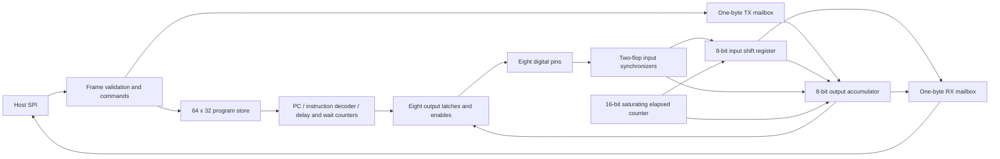

# Architecture and instruction set

## Datapath



There is one engine with a 6-bit PC, 8-bit accumulator A, 8-bit input shift
register ISR, 8-bit loop counter X, 12-bit delay/WAIT counters, and a 16-bit
saturating elapsed-clock counter. All state
except the instruction storage receives explicit synchronous reset. Output
enables are also immediately gated off by `rst_n`, deselection or a core fault.

Program words use flip-flops in this first implementation. A 64-bit validity map
is reset to zero, so uninitialized words cannot execute. No SRAM macro is
instantiated yet. Area and routing measurements must determine whether the
program store should move to a foundry macro or use a different depth/encoding.

START sets PC/A/ISR/X/output latches/enables/counters to zero, clears the core
fault and RX mailbox, and preserves the open-drain configuration and preloaded
TX byte. It is rejected while running. STOP halts, releases pins and clears both
mailboxes; it preserves program words, validity bits and the open-drain mask.
HALT preserves the final pin state. Reset/deselection invalidates the whole program.

## Encoding and execution

```
31          28 27                     16 15           8 7            0
+-------------+-------------------------+--------------+--------------+
| opcode (4)  | delay / timeout (12)    | operand a    | operand b    |
+-------------+-------------------------+--------------+--------------+
```

Every normally completed instruction takes **1 + delay** clock cycles. Its
action occurs on the first edge, followed by `delay` idle edges. Branches cost
the same number of cycles as other instructions. A program counter increment
from 63 wraps to 0; the assembler permits at most 64 instructions. A label at
the end of a 64-word program is not a legal branch target.

`WAIT` instead uses the delay field as a timeout: it checks the synchronized
input on every execution edge and completes on the first matching sample.
A nonzero N faults on the Nth consecutive nonmatching sample; zero waits
indefinitely. There is no post-WAIT delay. PULL and PUSH stall without advancing
until a mailbox is ready; their delay starts only after successful transfer.
HALT's encoded delay is irrelevant because execution has stopped.

| Hex | Assembly | Effect |
|---|---|---|
| 0 | `NOP [d]` | Delay only |
| 1 | `PINS value, enables [d]` | Atomically replace all output latches and enables |
| 2 | `SET value [d]` | A = value |
| 3 | `SETX count [d]` | X = count |
| 4 | `OUT pin, msb [d]` | Emit A[0] then shift right if msb=0; emit A[7] then shift left if msb=1 |
| 5 | `IN pin, msb [d]` | If msb=0 shift ISR right, inserting at bit 7; else shift left, inserting at bit 0 |
| 6 | `JMP address [d]` | Unconditional branch |
| 7 | `DJNZ address [d]` | If X>1, decrement and branch; otherwise set X=0 and advance |
| 8 | `WAIT pin, level [timeout]` | Wait for a synchronized input, with optional timeout |
| 9 | `PULL [d]` | Block until TX available, move TX to A and empty TX |
| A | `PUSH source [d]` | Block until RX empty, publish A (source=0) or ISR (source=1) |
| B | `XOR value [d]` | A = A XOR value |
| C | `ADD value [d]` | A = (A + value) modulo 256 |
| D | `JZ address [d]` | Branch if A is zero |
| E | `MASK value, mask [d]` | Replace only masked output bits; preserve enables |
| F | `HALT` | Stop execution and hold final output levels/enables |

Opcode 0 uses operand **a** as an extension selector and operand **b** for the
extension's immediate value. The canonical `NOP` has a=b=0. Programs emitted by
the original assembler retain their exact encoding and behavior; handwritten
opcode-0 words that previously used ignored nonzero a values must be reviewed.

| a | Assembly | Effect |
|---|---|---|
| 1 | `MOVISR [d]` | Copy ISR to A without changing ISR |
| 2 | `SAMPLE mask [d]` | A = synchronized GPIO inputs AND mask |
| 3 | `AND mask [d]` | A = A AND mask |
| 4 | `JNZ address [d]` | Branch if A is nonzero; address is in b |
| 5 | `TRESET [d]` | Set elapsed-clock counter to zero |
| 6 | `TSTAMP [d]` | Atomically capture elapsed clocks into ISR:A (high:low byte) |

The extension instructions have the usual 1+delay duration. Unknown selector
values retain NOP behavior. The assembler emits zero b for MOVISR/TRESET/TSTAMP;
hardware ignores b for these three instructions. An out-of-range JNZ target
faults even if A is zero, matching the existing branch validation policy.

OUT does not change enables. IN samples the pin independently of its output
enable, allowing readback. X=0 and X=1 both fall through DJNZ without wrapping.
IN followed by MOVISR, optionally AND/XOR, then JZ/JNZ permits decisions on
received data entirely inside the engine. SAMPLE can inspect multiple GPIO
inputs at once. These paths need no host transaction and have deterministic
instruction latency. OUT still destructively shifts A, so copy ISR again when
the original received byte is needed after transmission.

The elapsed counter counts every edge while running, including delays, WAIT,
and PULL/PUSH stalls. TRESET establishes an edge reference; an immediately
following TSTAMP reports 1. TSTAMP includes its own execution edge and snapshots
both bytes together, so subsequent mailbox stalls cannot tear the measurement.
It overwrites both A and ISR: publish any needed received byte first. STOP and
HALT retain the counter; START and reset clear it. The counter saturates at 65535
(about 2.731 ms at 24 MHz), and a captured 0xffff means **65535 clocks or more**.
It cannot distinguish longer intervals; firmware must reset it around the
event of interest. At reset/start, a first-instruction TSTAMP returns 1.

For example, TRESET; WAIT pin,1; TSTAMP measures through the first capture edge
after WAIT completes. WAIT consumes one execution edge and TSTAMP the next, so
even an already-high synchronized input reports 2. This measures the engine's
observation of an event; external-pad timing also includes the input synchronizer
latency described below. Clock accuracy and silicon pad delays need physical
validation before interpreting the value as an absolute wall-clock measurement.

The assembler validates counts, operand ranges, delay ranges and labels. Raw
machine code additionally receives hardware checks for out-of-range pin/branch
addresses. For OUT/IN/WAIT only b[0] is used; PUSH uses a[0]. Other unused bits
are ignored by RTL and should be zero in generated programs.

## Pins and timing

Open-drain operation uses `oe = direction & ~(open_drain & pins)`. Thus a
configured pin with latch 0 drives low; latch 1 releases it. External pull-ups
are required. PINS changes value and enable together on a clock edge. MASK
lets clock transitions preserve a data bit emitted by OUT.

Every external GPIO input crosses a two-flop synchronizer before the engine
uses it. Simulation observes an input change after two to three system-clock
edges, depending on its phase. This improves metastability containment but is
not a timing or MTBF sign-off. The first implementation has no synchronizer
bypass. Protocol limits must account for sampling latency and pad delays.

No derived clocks, PLLs, analog blocks, gated clocks, or asynchronous instruction
storage are used as clock sources. The entire control path is clocked by `clk`.

## Example timing and scope

At the intended 24 MHz clock:

- UART uses 208 clocks/bit: 115384.6 baud, about +0.16% relative to 115200.
  TX emits 8N1. RX is a one-byte, center-sampling example and checks the stop
  bit; continuous receive, parity, noise filtering and baud-drift testing remain.
- SPI modes 0-3 produce 120-clock half periods: 100 kHz. One host byte is sent
  while one byte is captured. Only controller, MSB-first operation is demonstrated.
- I2C writes one byte to address 0x50. Software waits for released SCL to rise,
  checks both ACKs and releases the bus on timeout. It is a single-controller
  example around 100 kHz; exact rate depends on synchronization and stretching.
  Additional combined-transfer examples provide a repeated START and one-byte
  read with controller NACK and STOP: the 49-word register-pointer read has no
  clock-stretch support; the 57-word empty-write/current-address read waits for
  released SCL and requires a target that accepts that transaction. Neither
  implements multi-controller arbitration or target operation. See
  [protocol demonstrations](protocol-demos.md) for their exact contracts.
- JTAG demonstrates reset from all 16 TAP states, a four-bit instruction value
  2, and an eight-bit data-register exchange. Shift-loop clock rate is 100 kHz;
  navigation has longer gaps. It requires a target with the documented IR/DR
  lengths, not an arbitrary device or multi-device scan chain.
- A 15-word [response measurement example](event-capture.md) launches a stimulus,
  classifies the input response locally, and captures its timing before the host
  drains results. Balanced branch paths preserve a common timing interpretation.

The engine itself has no UART/SPI/I2C opcode. Firmware can define new digital
waveforms within program capacity, execution speed and the available I/O.
